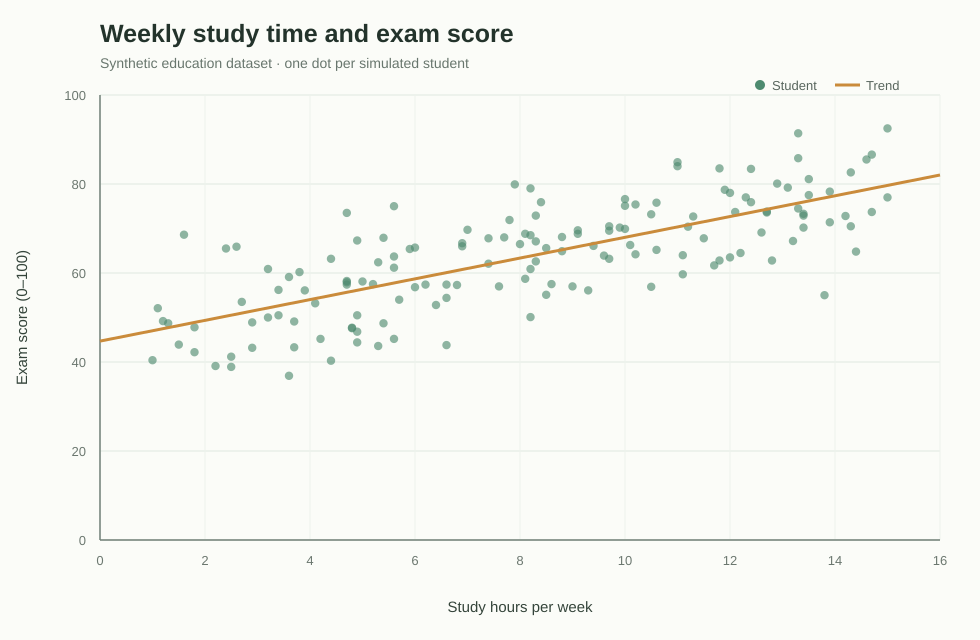
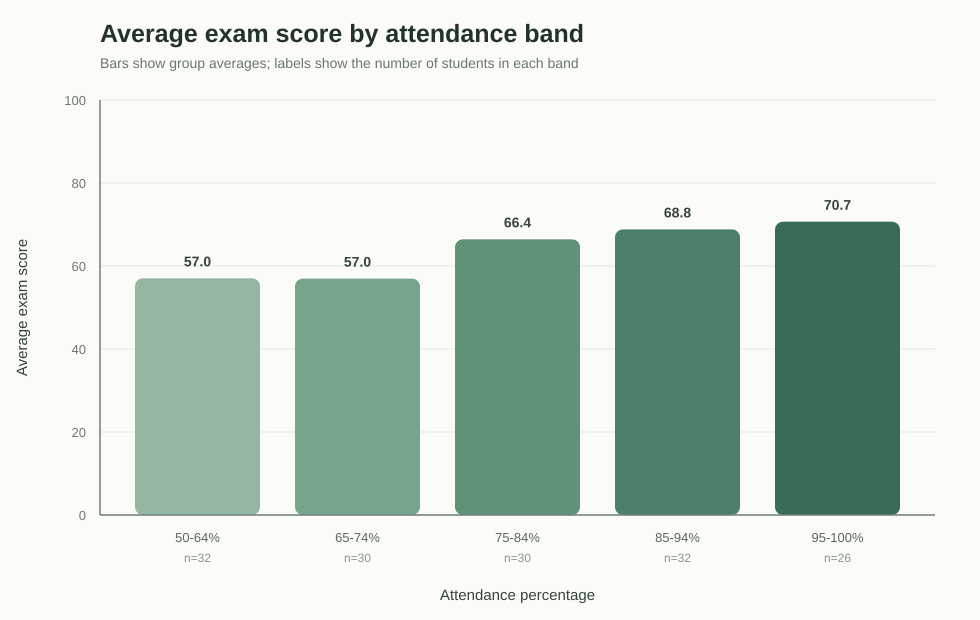

# Q.3 — AI-Powered Data Analysis and Hallucination Detection

## Dataset and method

This practical uses a **synthetic education dataset** of 150 simulated student records. It contains no real student information. The reproducible data-generation script is `generate_dataset.py`; run it before the analysis if you want to recreate the CSV. The analysis uses Python's standard library, so no package installation is required.

| Field | Meaning |
|---|---|
| `Student_ID` | Anonymous simulated record ID |
| `Study_Hours_Per_Week` | Weekly study hours |
| `Attendance_Percent` | Attendance percentage |
| `Assignment_Completion_Percent` | Percentage of assignments completed |
| `Tutoring_Hours_Per_Week` | Weekly tutoring hours |
| `Exam_Score` | Exam score from 0 to 100 |

The CSV has **150 rows and 6 columns**. Missing values: **0**. Exam score mean: **63.8**, median: **65.1**, range: **36.9–92.5**.

## Visualizations

1. **Study hours vs. exam score:** each point is one record; the line is a fitted linear trend. Pearson correlation is **r = 0.75**.

2. **Average score by attendance band:** bar labels show each band's mean; `n` is the number of records in the band.

## AI prompt and generated draft

**Prompt used with ChatGPT:** “You are an education data analyst. Review the student performance dataset. Give three concise patterns with numeric evidence, distinguish association from causation, and mention when the data does not support a conclusion.”

**Draft insights for review:**

1. Students studying at least 10 hours per week scored higher on average than students studying under 5 hours per week.
2. Attendance percentage has a positive association with exam score.
3. Tutoring raises exam scores by 10 points.

The third statement is included as a hallucination-detection challenge claim; it must be checked against the data before being accepted.

## Claim verification

| AI claim | Check against the CSV | Result |
|---|---|---|
| Study ≥10 hours is associated with higher scores than study <5 hours. | ≥10 hours: **73.6** average (`n=55`); <5 hours: **51.6** (`n=40`); difference **22.0** points. | **Supported as an association.** This does not by itself prove that study hours caused the difference. |
| Attendance is positively associated with exam score. | Pearson correlation **r = 0.48**; the attendance-band averages are plotted above. | **Supported as an association** in this synthetic dataset. |
| Tutoring raises scores by 10 points. | Any tutoring: **63.8** average (`n=96`); no tutoring: **63.7** (`n=54`); observed gap **+0.2** points. The generator deliberately does not use tutoring hours in its score formula. | **Incorrect for this dataset.** The claimed 10-point effect is not present; tutoring's measured difference here is a random-group comparison, not a causal estimate. |

## Conclusion and limitations

The dataset shows positive associations between exam score and study hours, and between exam score and attendance. The tutoring claim fails verification. The analysis is a classroom demonstration using simulated data: it cannot support conclusions about real students, and correlations from real observational data would not establish causation. Demographic factors and prior academic performance are not included.

## Run it in VS Code

1. Open this folder in VS Code.
2. Run `python generate_dataset.py` to recreate the CSV.
3. Run `python analyze.py` to regenerate the metrics, charts, and this report.
